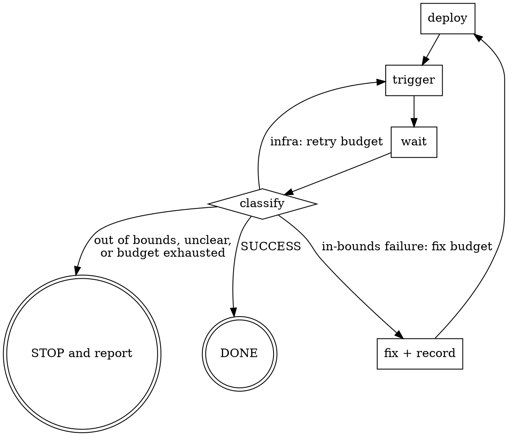

# dabctl Autopilot

## Overview

Drive a Databricks Asset Bundle to a green run using `dabctl`. Trigger, wait, classify the failure, fix it, redeploy, repeat.

**Core principle**, two independent budgets:
- Infrastructure failures cost a retry and requires no changes. This will typically be a GPU capacity issue.
- Real failures cost a fix attempt and require a code change. 

## When to Use

- Getting a DAB deployed and running, or a specific subset of its tasks
- A job run failed and needs diagnosis from its tracebacks
- Iterating on task code where each cycle needs a redeploy
- Completing a set of tasks with different configs - e.g multiple training runs with different hyperparameters.

Do NOT use for: authoring a bundle from scratch, Databricks workspace administration, or anything where `dabctl current` shows no configured job.

## Budgets


| Budget | Limit | Spent when | 
|---|---|---|
| Fix attempts | 3 | You change code, config, or deps and redeploy | 
| Infra retries | 10 | You re-trigger an unchanged run after an infra failure | 

Exhausting either budget means STOP and report. Do not raise a budget on your own initiative; ask. No retries have a backoff, you should re-try immediately.

## Preflight

- Run `dabctl current`. It must return a jobname, target, profile, and job_id. If it errors or returns empty, STOP and ask for `dabctl set <jobname> <target> <profile>` values — do not guess them.
- If task uses a multi-GPU setup, ask user if the instance size can be reduced (i.e g5.48xlarge -> g5.12xlarge), and after how many infra attempts this change should be made. Never make this change unless the user has specifically allowed you to do so.
- Ask the user if `dabctl deploy` needs to be run before start, if so, ensure that it is run.


## The Loop



Note the infra edge returns to **trigger**, not deploy. Nothing changed, so there is nothing to redeploy.

## Commands

```bash
dabctl current                                   # config + deployed versions
dabctl deploy                                    # deploy bundle to target
dabctl run --tasks a,b --params k=v              # triggers, polls to terminal — background this
dabctl run --no-poll ...                         # prints {"run_id": N} and exits, no waiting
dabctl analyse --run-id <id> --agentic-mode      # per-task state, error, error_trace
```

`--tasks` takes a comma-separated list in topological order. Omit it to run every task.

**Record the run_id in your first message after triggering.** The run continues on Databricks whether or not this session survives; the run_id is the only state needed to reattach. Losing it means losing track of a live run.

## Waiting

Never block a foreground call waiting for a run — they take minutes to hours. There is no automatic
sleep, and a foreground `sleep` is unavailable.

`dabctl run` already polls to a terminal state and already retries transient poll failures. Do not
rebuild that loop. Run it in the background and let its exit be the wake-up:

```
Bash(run_in_background: true): dabctl run --tasks a,b --poll-interval <interval>
```

The harness wakes you when the process exits, so the loop continues without needing a user turn. Ask
the user for the run's typical duration when starting this skill and set `--poll-interval` from it.

**Use the `run_in_background` parameter. Never background the command yourself** with `nohup`, a
trailing `&`, `disown`, `setsid`, or `screen`. A process you detach is not a harness task, so no
notification arrives when it exits, and you fall back to polling a log file — slower, and it burns
context on each check. A prefixed command such as `nohup dabctl run ...` also fails to match the
skill's `Bash(dabctl *)` grant, so it raises a permission prompt and stalls an unattended loop.

Read the background output file as soon as it exists: `run` logs `Triggered run <id>` before polling
begins, which is how you capture the run_id while the run is still going. On wake, that same file
holds the terminal state and termination code — read it first, and call
`dabctl analyse --run-id <id> --agentic-mode` when you need per-task tracebacks to diagnose a failure.

`dabctl run` exits 0 whether the run succeeded or failed, so never treat a clean exit as success.
Read the state.

If a long run's background process is killed before the run finishes, fall back to `Monitor` with
`persistent: true`. The run itself is unaffected — reattach with the run_id.

Treat a run as finished only when `status.state` is terminal (`TERMINATED`, `INTERNAL_ERROR`, `SKIPPED`).

## Classification

Read `status.termination_details.code` plus every task's `state`, `state_msg`, `error`, and `error_trace`.

| Signal | Class | Action |
|---|---|---|
| `SUCCESS` | done | Report and stop |
| `RESOURCE_NOT_AVAILABLE`, or capacity/quota/"no available" language in `state_msg` | infra | Re-trigger unchanged, spend a retry |
| Python traceback in `error_trace` | code | Fix source, spend a fix |
| Task wiring, missing param, bad dependency order, cluster/env config | config | Fix bundle definition, spend a fix |
| `ImportError`, `ModuleNotFoundError`, version conflict, wheel build failure | deps | Fix packaging, spend a fix |
| Missing/changed upstream table, unexpected schema, empty input | data | STOP and report |
| Permission, credential, catalog or workspace access denied | access | STOP and report |
| Anything you cannot confidently place above | unknown | STOP and report |


When several tasks fail, fix the earliest failure in dependency order first — downstream failures are usually consequences.

## Multi-Task Runs

A multi-task run is one run of several tasks, e.g. `--tasks task_A,task_B`. Tasks complete
independently, so a later task can fail after an earlier task succeeds.

**Re-trigger only the tasks that need to run again.** A completed task keeps its output on
Databricks. Running it a second time costs time and money, and on GPU tasks it competes for the
capacity you are already short of.

| Situation | What to put in `--tasks` | 
|---|---|
| Infra failure | The failed task and every task after it. Nothing changed, so completed output stays valid. |
| Fix touches only the failed task's code | The failed task and every task after it. |
| Fix touches code a completed task also runs | The full original list. |

The third row is the one that is easy to miss. A completed task's output comes from the code that
was deployed when it ran. If your fix changes a shared module, the wheel, or a job cluster that the
completed task also uses, that output is now stale. Re-run the full list.

Keep the tasks in topological order, as `--tasks` requires.

When you narrow the list, the run that goes green covers only part of what the user asked for.
Report which tasks ran in the final run, and give the run_id where each remaining task last
succeeded. Never call the whole list green from a run that did not include all of it.

## Sweeps

A sweep is several runs of the same tasks with different configurations, e.g. one run per hyperparameter set.

Run configs **one at a time, in the given order**. The first config is a canary for the shared code: if it fails for a real reason, every later config would hit the same bug, so fixing before proceeding is cheaper than discovering it N times.

| Rule | Behaviour |
|---|---|
| Order | Sequential. Never trigger the next config before the current one is terminal. |
| Fix budget | **Global — 3 across the whole sweep.** A code fix changes shared code, so it isn't per-config. |
| Infra retries | **Per config — 10 each.** Each config independently rolls the dice on capacity. |
| Real failure | Halt the sweep. Fix, then re-run the config that failed before moving on. |
| Infra failure | Not a halt. Retry that config; the sweep is still on track. |

Write down the full config list and each config's run_id and outcome as you go. Report the sweep as a table of config → run_id → outcome, including configs never reached and why.

If a config fails for a reason specific to its own params rather than the shared code — an out-of-range value, an invalid combination — say so explicitly when you halt. That distinction tells the user whether their sweep definition or their code is wrong.

## In Bounds vs Stop

**Fix autonomously:** task source code, the bundle definition, dependency and packaging files.

**Always STOP and report, never fix:** anything that writes to or alters data or tables, anything needing a credential or permission change, and anything where your diagnosis is a guess.

Before each redeploy, state in one or two lines: what failed, what you changed, and why that addresses it.

## Red Flags — STOP and Report

- About to spend a fix attempt without having read the `error_trace`
- About to apply the same fix a second time
- About to write to a table, grant a permission, or edit credentials to make a run pass
- About to raise a budget, or "just one more" past a limit
- About to declare success without a terminal `SUCCESS` in `analyse` output
- Reaching for a data fix because the code fix isn't obvious
- About to trigger a sweep's next config before the current one is terminal

## Rationalizations

| Excuse | Reality |
|---|---|
| "The GPU retries are failures too, count them as fixes" | Infra failures carry no diagnostic signal. Separate budgets exist precisely so capacity misses can't mask real bugs. |
| "It's probably the same root cause, I'll fix it blind" | Read the traceback. A fix attempt without evidence is a guess that burns a third of the budget. |
| "I'll just backfill the missing table so it runs" | Writing data is out of bounds. Report the missing upstream and stop. |
| "One more attempt and it'll pass" | The cap is the cap. Report where it stands and let the user decide. |
| "The last run failed but only in a flaky task, close enough" | Green means terminal SUCCESS. Nothing else is done. |
| "Deploy is slow, I'll skip it after this edit" | An unrebuilt bundle runs the old code. Every code change needs a deploy. |
| "I'll `nohup` it so the run survives" | The run already survives — it lives on Databricks, not in this shell. Detaching only costs you the wake-up notification. Use `run_in_background`. |
| "Re-running the completed tasks too is only a few more minutes, and it is safer" | It is not safer, it is slower and it burns GPU capacity on work that is already done. Narrow the list unless the fix touched code a completed task also runs. |
| "Firing the whole sweep at once is far quicker" | Sequential is the rule. Parallel configs multiply a shared bug across every run and compete for the capacity you're already short of. |
| "This config's failure is unrelated, I'll keep the sweep going" | A real failure halts the sweep. If it truly is config-specific, say so when you halt and let the user decide. |

## Reporting

On exit — green, exhausted, or out of bounds — report the final run_id, the terminal state, what was changed across iterations, and what remains if it isn't green. Say plainly that a run failed when it failed.
